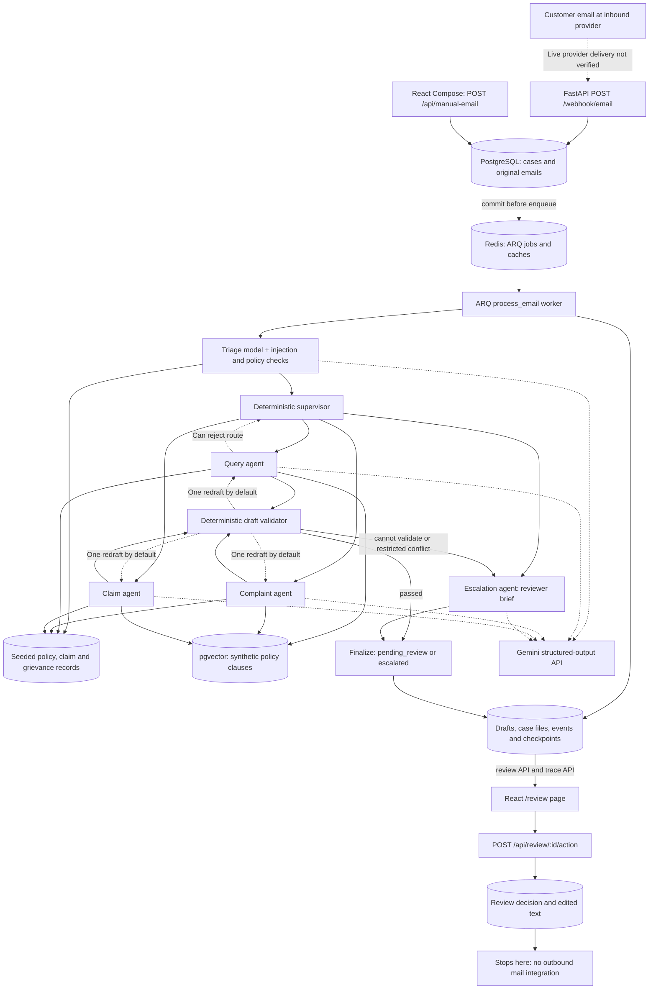

# How the existing system works

Phase 1 explanation, 21 October 2026. All paths below are relative to the repository root. This describes current execution, not a proposed replacement architecture.

## The short explanation

Think of Dak as a mailroom with a filing cabinet, a dispatcher, several specialist desks and a review desk. It can organize an email and prepare a response with references. Today, the final action is saving a human decision. There is no postman: nothing connects those decisions to an outgoing email provider.

## Architecture diagram

The Redis job is a notification that work is waiting; PostgreSQL holds the durable email. The worker is a separate process, not a request that keeps running in the browser. Database checkpoints preserve graph progress. A running worker also periodically finds emails whose queue dispatch was lost.

## 1. What agents actually exist?

| Agent | Actual work | Main entry point |
|---|---|---|
| Triage | Injection screening, model classification/confidence, policy extraction/lookup, regulatory keyword flag | `app/agents/triage.py:run` |
| Query | Generic coverage questions, clause retrieval, guarded generic cache, optional policy-detail lookup for personal questions | `app/agents/query.py:run` |
| Complaint | Model grievance subtype, historical grievances/claims, repeated/disputed-claim review flags, draft and internal note | `app/agents/complaint.py:run` |
| Claim | Explicit event-date extraction/check, attachment filename inventory, code-calculated eligibility, advisory case file, neutral acknowledgement | `app/agents/claim.py:run` |
| Escalation | A structured brief explaining what the human needs to resolve; deterministic fallback if model unavailable or unsafe to invoke | `app/agents/escalation.py:run` |

There are five agent modules. The supervisor, validator and finalizer are additional graph nodes, implemented in code rather than separate free-form LLM agents. There is no separate service/technical agent, reimbursement agent or general “other” drafting agent. Unknown and mixed intents go to escalation.

## 2. How does the orchestrator work?

`app/graph/build.py:build_graph` assembles a LangGraph state machine. It starts with Triage, then calls the supervisor. `app/graph/supervisor.py:route_decision` applies rules in a fixed order before ordinary category routing.

For a normal query, the path is:

`triage → supervisor → query_agent → validator → finalize → pending_review`.

A specialist can request another route. The default allows one reroute. A failed draft validation can return to its originating specialist once; both draft attempts are kept. Further failure escalates. These limits are configurable in `Settings`; graph recursion is also bounded at 32. The Gemini adapter caps counted model calls at eight per run, including invalid-output retries.

The graph is supervisor-routed, but tools are mostly explicitly called by the Python agent functions. It is not an unrestricted model selecting arbitrary tools or independently messaging other agents.

## 3. What data is passed between agents?

Agents share a JSON-serializable `RunState` (`app/graph/state.py`). They do not call each other directly. `process_run` initially loads identifiers, case token, subject, plain email body and original webhook JSON from PostgreSQL.

| State/context | Where it comes from | Who uses it |
|---|---|---|
| Run/email/case IDs and token | Operational database | Graph, logging and persistence |
| Original subject and plain body | Stored email | Every model prompt via `AgentContext.model` |
| Raw webhook payload | Stored original JSON | Claim attachment inventory; retained state/checkpoints |
| Category, confidence, policy-number flags, sentiment, urgency, reasoning | Triage model with code overrides/checks | Supervisor and downstream context |
| Policy record and product code | PostgreSQL lookup by extracted number | Product selection, query/claim tools, validator dates |
| Retrieved clauses and similarity scores | pgvector search for product/corpus version | Specialist drafting and validator |
| Complaint history and subtype | SQL tools and model subtype call | Complaint prompt; tool-result events |
| Eligibility, extracted facts, missing documents | Claim code and model facts | Claim drafting, case file and reviewer brief |
| Draft sentences, citations, violations, internal notes | Specialists and validator | Redrafting, review, escalation |
| Route history, retry counts, errors, cache flags | Graph/tool wrappers | Control flow, receipts and audit trace |

Important boundaries:

- The actual model prompt is subject/body plus the context chosen by that specialist (`app/agents/runtime.py:AgentContext.model`), not a dump of all graph state.
- Original sender is stored but is not a dedicated state/model prompt field. Raw provider JSON may contain it, but that is not sender authorization.
- Query prompts include a full policy record only for personal-query patterns; generic query drafts use clauses and can use the semantic cache.
- Complaint prompts get history and clauses. Claim drafting gets facts, calculated eligibility, clauses and filename inventory; it does not automatically get the complete prior email conversation or attachment contents.
- The code HTML-escapes email/context delimiter characters and tells the model to treat them as untrusted data. This is a guard, not proof that all prompt injection is detected.

## 4. How are insurance details fetched?

There are two sources with different purposes:

1. **A customer's record:** `app/tools/policy.py` queries the `policies`, `claims` and `grievances` tables. `lookup_policy` returns a typed `PolicyRecord`; `get_policy_details` delegates to that lookup; `get_case_history` returns claim/grievance history. The data is locally seeded synthetic information, not a live insurer API.
2. **General policy wording:** `app/rag/index.py:index_corpus` verifies checksums and PDF/Markdown agreement, embeds clauses and stores them in `policy_chunks`. `search_policy_docs` searches cosine similarity within a product and corpus version. It defaults to five results and a 0.30 score floor. `RETRIEVAL_TOP_K` is declared in configuration, but the search uses its `k=5` argument; the config field is not wired through the agent call.

The embedding model is pinned `all-MiniLM-L6-v2`, runs on CPU, and produces 384-dimensional vectors. Redis caches retrieval for six hours. The semantic cache only admits tightly constrained generic answers, rechecks current clause content and still passes hits through the validator.

“Verified” here means retrieved from the configured, integrity-checked synthetic sources. It does not mean independently verified against a real insurer. The lookup does not verify that the sender is the policyholder. `PolicyLookupResult.active` tests the status label; event-date eligibility separately checks dates and cancellation conditions.

## 5. How are confidence scores determined?

Gemini supplies `TriageAssessment.confidence`, constrained to 0–1. The prompt describes it as confidence that the chosen category is correct and suggests lower confidence for ambiguity. There is no statistical calculation or calibration step producing the value.

The supervisor escalates when confidence is **less than** `CONFIDENCE_THRESHOLD` (default 0.70). A value exactly 0.70 does not trip that rule. This is category confidence, not confidence in delivery safety or factual correctness. Retrieval similarity is another number entirely and should not be confused with classification confidence.

The injection short-circuit constructs confidence 1.0 with `injection_detected=true`; it still escalates. High confidence alone never establishes permission to answer or send.

Evaluation tables and a calibration chart reader exist, but no completed held-out email evaluation establishes a reliable automatic-send threshold. The 0.90 auto-send setting is unused.

## 6. What triggers HITL?

Today **all** normal completed runs require review. Some are placed in the escalation queue with a reason.

The supervisor checks, in order:

1. Missing/invalid triage output.
2. Prompt injection flag.
3. Regulatory/legal language flag.
4. Confidence below 0.70.
5. Mixed intent.
6. Unknown intent.
7. A claimed policy number not found.
8. Tool errors or existing escalation reasons.
9. Invalid/excessive route changes.

Other paths escalate for absent product/context, missing supported event date, invalid output, repeated grievances, a disputed historical claim referenced in a complaint, certain accident/waiting-period conflicts, or exhausted validation retries. Complaint repetition currently counts at least two open/closed historical grievance records; not every possible history is handled as repetition.

Claims normally visit the claim specialist first; some receive a case-file recommendation such as `refer_underwriting` without changing the run into the escalation queue. They still end at `pending_review`. There is no explicit “mandatory HITL for every reimbursement” send guard, because there is no sending path to guard yet. This must be made explicit before auto-send is introduced.

## 7. How does the HITL dashboard talk to the backend?

React uses `fetch` in `frontend/src/api.ts`. The Vite development server proxies `/api` and `/health` to port 8000 (`frontend/vite.config.ts`). No login token or reviewer identity is attached.

| Browser action | Backend request |
|---|---|
| Open pending drafts or escalations | `GET /api/review/queue?status=pending_review` or `status=escalated` |
| Select a case | `GET /api/review/{run_id}` |
| Approve/Edit/Reject | `POST /api/review/{run_id}/action` |
| Open processing trace | `GET /api/runs/{id}/detail` and incremental `/events?after_seq=N` |
| Activity | `/api/runs?limit=50` and `/api/metrics/summary` |
| Evaluation | `/api/eval/runs`, per-run metric/result routes |

The review API supports queue pagination, but the UI does not expose page navigation beyond its default response. Selection/status is stored in URL parameters. Review refresh is manual and after a decision; the run page polls events while visible, normally every 1.5 seconds until a terminal state. Activity refreshes every 15 seconds.

Citations are opened as inline source panels. Claim files, internal notes and escalation briefs are expandable JSON. A real payload nesting mismatch means the triage reasoning paragraph generally shows its fallback rather than the model's reasoning; full evidence remains in the expandable object. There is no attachment viewer, dedicated policyholder summary, delivery panel or login screen.

## 8. What happens after Approve, Edit or Reject?

`app/api/routes_review.py:review_action` locks the run row and rejects already-decided runs. A unique `Review.run_id` provides an additional database guard.

| Action | Current checks and persistence | Email result |
|---|---|---|
| Approve | Run awaiting review; latest draft must exist and pass validation; save Review; run becomes approved | Nothing sent |
| Edit | Run awaiting review; edited text must be nonempty; save text/note in Review; run becomes approved | Nothing sent |
| Reject | Run awaiting review; save rejection/note; run becomes rejected | Nothing sent |

Edits are stored separately; original AI draft attempts remain intact. An edit is not revalidated and does not require an AI draft at the API boundary. A direct unauthenticated edit on a no-draft escalated run succeeded in the audit probe, even though the UI disables editing when no latest draft exists.

The frontend displays “Decision recorded. No email was sent.” and refreshes the queue after 1.8 seconds. Decided cases disappear from the default review queues. The API does not update the case status, attach a reviewer identity, append a review `RunEvent`, send anything, or return the persisted Review in detail responses. Run status `approved` is a review result, not proof of delivery.

## 9. How are outgoing emails sent?

They are not sent. No SMTP client, provider send adapter, outbound job, delivery webhook or message outbox was found. The database's `Email.direction` string can hold `outbound`, but the presence of that column does not create outgoing messages. `AUTO_SEND_ENABLED` and `AUTO_SEND_MIN_CONFIDENCE` are unused declarations, not an integration switch.

Consequently, automatic replies, approve-and-send, edited sending, inbox receipt, bounce tracking and failed-delivery recovery cannot be demonstrated by configuration alone.

## 10. How are failures, retries, duplicates and logs handled?

| Situation | Actual behavior | Important limit |
|---|---|---|
| Webhook authentication fails | HTTP 401 before storing email | It authenticates the webhook caller, not the customer or reviewer. |
| Payload cannot be parsed | Store a hash-identified unparseable raw email; HTTP 200; no processing job | No repair/reprocess UI. Parser tests cover representative failures, not every arbitrary JSON type. |
| Same Message-ID arrives again | Reuse stored email; enqueue stable `email:{id}` job; HTTP duplicate response | It is Message-ID idempotency, not universal duplicate-content detection. |
| Queue unavailable after commit | Webhook returns 503; data remains durable; provider retry can requeue | Manual API instead returns 202 and relies on reconciliation. |
| Dispatch lost | Worker startup and minutely reconciliation requeue unfinished parseable emails | Worker must be alive; it scans batches of 100. |
| Concurrent email processing | PostgreSQL advisory lock; contention raises ARQ Retry with two-second delay | Run/email uniqueness is enforced by this execution path, not a unique `runs.email_id` constraint. |
| Malformed model JSON | Up to three adapter attempts with short backoff; every attempt consumes call budget | Does not mean every provider error is retried three times. |
| Provider HTTP 429 | Typed rate-limit exception; ARQ Retry after 60 seconds | Worker max tries is 3. Permanent quota and retry-exhaustion operations need verification. |
| Other typed model/tool failure | Graph usually produces an escalation with trace/fallback brief | Rate limiter/infrastructure exceptions outside typed handling can instead fail a run. |
| Validator blocks output | Retain attempt, return violations for one redraft by default, then escalate | Citation existence does not prove semantic correctness. |
| Direct graph interruption | PostgreSQL checkpoints and node receipts can resume completed nodes | A direct graph resume test passed, but that is not the same as worker failure recovery. |
| Unexpected worker exception | Mark run failed and log error | `failed` is terminal. Later worker calls/reconciliation skip it; no retry endpoint exists. |
| Failed outgoing delivery | No such operation exists | No delivery retry, bounce or dead-letter mechanism can be tested. |

Processing events are stored with per-run sequence numbers, node names, tool inputs/results, model-call usage/errors and durations. `write_event` locks the run during sequence allocation. Model provider events distinguish real Gemini from injected recorded transports. Draft attempts and claim case files are also persisted. This is useful debugging evidence, but not tamper-proof audit storage; reviewers and deliveries have no complete audit trail. Langfuse settings/dependency exist without connected runtime publishing.

## What the tests establish

The fresh audit passed 150 backend tests and a production frontend build. Tests verify routing, persistence, deterministic validation, reference integrity, representative ingestion, real local queue dispatch, concurrent review decisions and direct PostgreSQL checkpoint resumption. Model output is scripted; it is not a live assessment of insurance-answer quality. Read [implementation-audit.md](implementation-audit.md) for exact evidence and additional probes.
